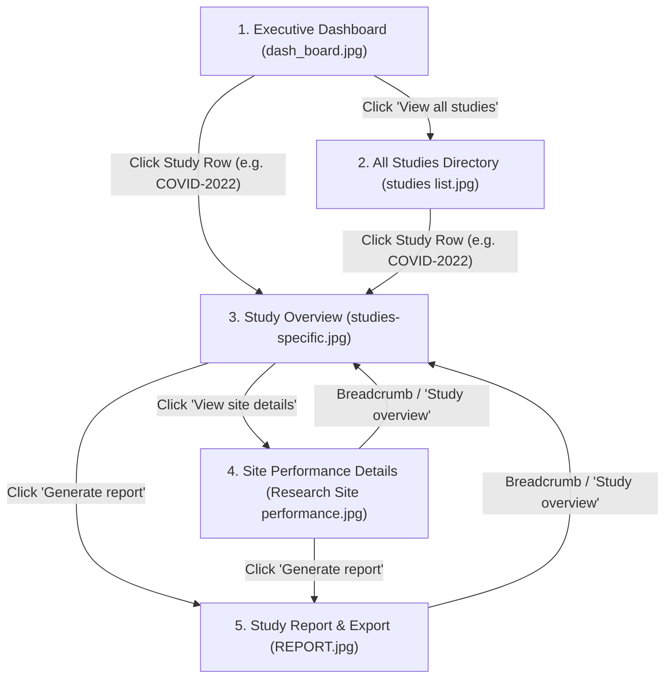

# Product Requirements Document (PRD)

| | |
|---|---|
| **Project** | PaperTrail Clinical Research Dashboard |
| **Version** | 2.0 (Full 5-Screen Investigative Workflow) |
| **Status** | Approved Specification |
| **Architecture** | Single Page Application (SPA), Client-Side URL State Engine |

---

## 1. System Architecture & Tech Stack

The application **MUST** adhere strictly to the following technical stack:

- **Framework:** React 18+ (bootstrapped with Vite)
- **Styling:** Tailwind CSS (utility-first, semantic tokens, no unconstrained custom CSS files)
- **Icons:** Lucide React
- **Data Visualizations:** Responsive Native SVG / CSS data visualizations (zero external chart dependencies)
- **State Management:** Native React state (`useState`, `useMemo`, `useCallback`)
- **Persistence:** Read-only bundled JSON file (`src/data/projects.json`)
- **Deployment Target:** Vercel (static single-page build: `vite build`)

---

## 2. Global Shell & Persistent Layout

All views are hosted within a persistent unified PaperTrail shell modeled after the UI templates:

1. **Left Navigation Sidebar (Collapsible on Mobile):**
   - Brand logo: **PaperTrail**
   - Navigation Items:
     - `Dashboard` (links to Screen 1)
     - `Studies` (links to Screen 2)
     - `Site Health` (contextual or redirects to default study sites)
     - `Reports` (contextual or redirects to default study report)
     - `Analytics` (mock disabled / overview)
     - `Settings` (mock disabled / overview)
2. **Top Application Bar:**
   - Global Search input (`"Search studies, sites, patients..."`)
   - Notification Bell with unread counter badge (`12`)
   - User Profile pill with avatar and user label (`JOHN HENRY`)

---

## 3. Data Schema Contract

All study, site, and regulatory records must adhere strictly to the following TypeScript contract in `src/types/project.ts`:

```typescript
export type ResearchPhase = "Phase I" | "Phase II" | "Phase III" | "Phase IV" | "Phase IX";
export type ProjectStatus = "Active" | "Recruiting" | "Completed" | "Suspended" | "On Hold" | "Inactive";
export type RiskLevel = "Critical" | "High" | "Medium" | "Low";
export type SiteStatus = "Ongoing" | "Planned" | "Completed" | "Pending";
export type ComplianceRating = "High" | "Medium" | "Low";

export interface TrialSite {
  id: string;
  name: string;
  status: SiteStatus;
  enrolled: number;
  target: number;
  dropOffRate: number; // Percentage integer: e.g. 14 for 14%
  compliance: ComplianceRating;
  riskLevel: RiskLevel;
}

export interface KeyFinding {
  id: string;
  severity: "Critical" | "High" | "Medium";
  title: string;
  description: string;
  recommendation: string;
}

export interface MonthlyEnrollmentPoint {
  month: "Jan" | "Feb" | "Mar" | "Apr" | "May" | "Jun" | "Jul" | "Aug" | "Sept" | "Oct" | "Nov" | "Dec";
  actual: number;
  target: number;
}

export interface ClinicalProject {
  id: string; // Identifier & slug: "COVID-2022", "CRD-1001", etc.
  title: string;
  protocolNumber: string; // e.g. "CNT-2022-004", "PRT-90210"
  sponsor: string; // e.g. "Federal Government", "National Institute of Health"
  phase: ResearchPhase;
  status: ProjectStatus;
  riskLevel: RiskLevel;
  principalInvestigator: string;
  researchManager: string;
  therapeuticArea: "Oncology" | "Cardiology" | "Neurology" | "Immunology" | "Infectious Disease";
  enrollment: {
    current: number;
    target: number;
  };
  timeline: {
    startDate: string; // ISO format "YYYY-MM-DD"
    endDate: string; // ISO format "YYYY-MM-DD"
    elapsedPercent: number; // e.g. 27 for 27%
    timeRemaining: string; // e.g. "3 months remaining"
    daysRemaining: number; // e.g. 88
    patientsBehindTarget?: number; // e.g. 947
  };
  metrics: {
    sitesCount: number; // Total sites (e.g. 34)
    activeSites: number; // Active site count (e.g. 6)
    sitesAtRisk: number; // At-risk site count (e.g. 4)
    sitesNeedAttention: number; // Sites needing immediate attention (e.g. 2)
    dropRate: number; // Overall study drop-off / subject withdrawal rate % (e.g. 17)
    complianceScore: number; // Protocol adherence score (e.g. 3 or 85)
    openIssuesCount: number; // e.g. 3
  };
  monthlyTrend: MonthlyEnrollmentPoint[];
  sites: TrialSite[];
  keyFindings: KeyFinding[];
  regulatory: {
    protocolVersion: string; // e.g. "v2.1 (Apr 2024)"
    irbStatus: "Approved" | "Pending" | "Under Review";
    fdaIndNumber: string; // e.g. "IND-142857"
    reportingPeriod: string; // e.g. "Jan 2026 - Apr 2026"
    reportDate: string; // e.g. "January 15, 2026"
    preparedBy: string; // e.g. "Dr Chinonso Egemma (Research monitor)"
    reportingPeriodEnd: string; // e.g. "Apr 30, 2024"
  };
  startDate: string;
  lastUpdated: string;
  description: string;
  primaryEndpoint: string;
}
```

A realistic dataset with at least 8 complete records—including full details for flagship study **COVID-2022**—must be bundled in `src/data/projects.json`.

---

## 4. Core State & Navigation Logic

The application does **NOT** use external router libraries. It is driven by a single-state view engine synchronized with URL search parameters via `window.history.pushState` and `window.onpopstate`:

### State Variables

| Variable | Type | Allowed Values |
|---|---|---|
| `activeView` | `string` | `"dashboard"` \| `"studies"` \| `"study-detail"` \| `"site-performance"` \| `"study-report"` |
| `selectedStudyId` | `string \| null` | Resolves to a valid `ClinicalProject.id` (e.g. `"COVID-2022"`) |

### URL Synchronization Contract

- **Executive Dashboard:** `/?view=dashboard` (or default root `/`)
- **All Studies Directory:** `/?view=studies`
- **Study Overview (Command Center):** `/?view=study&id=COVID-2022`
- **Site Performance Details:** `/?view=sites&id=COVID-2022`
- **Study Report & Export:** `/?view=report&id=COVID-2022`

### Navigation Matrix & User Flow



- **Browser Back / Forward:** Full synchronization ensures browser history steps through previously viewed dashboard, study, site, and report views seamlessly.

---

## 5. Screen-by-Screen Specifications

### Screen 1: Executive Dashboard (`dash_board.jpg`)

- **Header Section:**
  - Heading: `"Research Overview"`
  - Subtitle: Count summary (e.g. `"5 studies - 1,200 of 4,500 patients enrolled"`)
  - Primary Action Button: `[+ View all studies]` (triggers navigation to Screen 2)
- **Top Metric Cards (4 Cards):**
  1. **Active Studies:** Active study count + subtitle (`"24 total studies in system"`)
  2. **Patients Enrolled:** Total enrolled patients + subtitle (`"of 5,000 across all studies"`)
  3. **Overall Enrolment Rate:** Aggregate % + subtitle (`"across all studies"`)
  4. **Sites at Risk:** Count of sites at risk + subtitle (`"of 52 sites total"`)
- **Middle Visualizations Grid (2 Columns):**
  - **Left Card (Monthly Enrollment Trend):** Responsive SVG line chart comparing `Enrolled` (solid blue curve) vs. `Target` (light blue reference curve) across Jan – Dec.
  - **Right Card (Enrollment by Study):** Progress bar list for flagship trials (e.g., `COVID - 2022`, `LS-FEVER - 2025`, `WHO - AIDS - 2026`, `MEASLES - 2024`) with `[See all]` action.
- **Bottom Summary Table:**
  - Table Columns: `STUDY` (with Phase), `STATUS`, `ENROLMENT` (percentage & visual bar), `RISK LEVEL` (High / Medium / Low), `SITES AT RISK`.
  - Row Click: Navigates directly to Screen 3 for the selected study.

---

### Screen 2: All Studies Directory (`studies list.jpg`)

- **Breadcrumb:** `Dashboard > Studies`
- **Header Section:**
  - Heading: `"All Studies"`
  - Subtitle: Portfolio stats (e.g. `"5 studies - 1,200 of 4,500 patients enrolled"`)
  - Action Button: `[+ New study]` (accessible trigger with toast/placeholder feedback)
- **Metric Ribbon (4 Cards):**
  1. `Active` (count with green checkmark icon)
  2. `Delayed` (count with amber warning icon)
  3. `Critical Risk` (count with red alert icon)
  4. `Average enrollment rate` (percentage with blue info icon)
- **Controls Toolbar:**
  - Debounced search input (`"Search studies, sites, patients..."`)
  - Filter / Sort controls (`Sort by`, Status, Therapeutic Area)
- **Studies Directory Table:**
  - Table Columns: `STUDY`, `STATUS` (semantic pill badge), `ENROLMENT` (progress bar + % label), `RISK LEVEL` (CRITICAL / HIGH / MEDIUM / LOW color pills), `SITES` (count), `PHASE`, `RESEARCH MANAGER`.
  - Row Click: Navigates to Screen 3 for the selected study.
  - Mobile Fallback: Responsive stacked card layout (`block md:hidden`).

---

### Screen 3: Study Command Center (`studies-specific.jpg`)

- **Breadcrumb:** `Dashboard > Studies > [Study ID]`
- **Header Section:**
  - Badges: `[Phase]`, `[Risk Level]` (e.g., High Risk / Critical), `[Status]` (e.g. ACTIVE)
  - Study Title: e.g. `"COVID -2022 Vaccine Trial"`
  - Protocol & Sponsor: `"Protocol: CNT-2022-004 | Sponsor: Federal Government"`
  - Top Action Buttons:
    - **`[Generate report]`** (navigates to Screen 5)
    - **`[View site details]`** (navigates to Screen 4)
- **Timeline Banner:**
  - Horizontal progress bar: `"Timeline: 27% elapsed | 3 months remaining"`
  - Dates: `"Start: 2026-01-24"` and `"End: 2026-11-30"`
- **Study Diagnostic Metric Ribbon (4 Cards):**
  1. **Current Enrollment:** Count + `% Of Site Target`
  2. **Enrollment Rate:** Percentage + `"Patients Behind Target"` badge
  3. **Active Sites:** Count + `"Sites Need Attention"` note
  4. **Time Remaining:** Months + `"Days To End Of Study"`
- **Content Grid (2 Columns):**
  - **Left Card:** Monthly Enrollment Trend line chart (Actual vs. Target for this study).
  - **Right Card:** `"Site Performance"` ranking list (e.g. Ibadan Medical Center, Lagos Community Health, Kano Health Services, Abuja Wellness) with enrollment percentages and `[See all]` link.

---

### Screen 4: Site Performance Details (`Research Site performance.jpg`)

- **Breadcrumb:** `Dashboard > Studies > [Study ID] > Site Performance Details`
- **Header Section:**
  - Heading: `"Site Performance"`
  - Subtitle: `"[Study ID] | [Study Title] | [X] active sites"`
  - Top Action Buttons:
    - **`[Study overview]`** (navigates back to Screen 3)
    - **`[Generate report]`** (navigates to Screen 5)
- **Site Operational KPIs (4 Cards):**
  1. **Total Enrolled:** Count + `% of Site Target`
  2. **Sites at Risk:** `[At Risk] / [Total]` + `"Critical Risk Level"`
  3. **Drop Rate:** `% Subject Withdrawal Rate`
  4. **Average Compliance:** Score / 5 + `"Protocol Adherence Score"`
- **Performance Layout Grid:**
  - **Left Column:** `"Enrollment by site"` progress list with patient counts for all trial sites.
  - **Right Column:** Comprehensive `"Site Performance"` Table:
    - Columns: `SITE`, `ENROLLED` (Status: Ongoing / Planned / Completed / Pending), `DROP-OFF` (visual bar + % rate), `COMPLIANCE` (High / Medium / Low), `RISK` (Critical / High / Medium / Low).

---

### Screen 5: Study Report & Export (`REPORT.jpg`)

- **Breadcrumb:** `Dashboard > Studies > [Study ID] > Report & Export`
- **Header Section:**
  - Heading: `"STUDY REPORT AND EXPORT"`
  - Subtitle: `"[Study Title] || GENERATED [Date]"`
  - Action Buttons:
    - **`[← Study overview]`** (returns to Screen 3)
    - **`[Print]`** (triggers `window.print()`)
    - **`[Export pdf]`** (browser print-to-PDF / notification trigger)
- **Confidential Document Banner:**
  - Blue certificate card: `"CLINICAL RESEARCH REPORT || CONFIDENTIAL"`
  - Study Title, Protocol, Sponsor
  - Metadata Grid: `Reporting Period`, `Status`, `Report Date`, `Prepared By`
- **Report Summary KPIs (4 Cards):**
  1. **Total Enrolled**
  2. **Overall Rate** (`Vs Expected Rate`)
  3. **Sites at Risk**
  4. **Open Issues** (`Across X Sites`)
- **Report Two-Column Body:**
  - **Left Column (Key Findings):**
    - Stacked audit finding cards categorized by severity:
      - **CRITICAL:** Finding title, detailed compliance audit text, and bold **`RECOMMENDATION:`** directive (e.g., CAPA initiation, on-site CRA inspection).
      - **HIGH:** Finding title, patient retention audit, and **`RECOMMENDATION:`** directive.
      - **MEDIUM:** Finding title, data query adherence, and **`RECOMMENDATION:`** directive.
  - **Right Column (Protocol & Study Metrics Card):**
    - Protocol Version (`v2.1`)
    - IRB Status (`Approved`)
    - FDA IND Number (`IND-142857`)
    - Primary PI (`Dr. Amelia Chen`)
    - Sites Active (`6`)
    - Avg. Compliance (`85%`)
    - Reporting Period End (`Apr 30, 2024`)

---

## 6. UI Boundary States

1. **Study Not Found:**
   - Triggered when URL parameter `?id=UNKNOWN` does not match any record.
   - Renders an informative empty state with a direct button back to Dashboard or Studies Directory.
2. **Empty Search / Filter Results:**
   - Filtered array length is 0.
   - Displays `SearchX` icon, `"No matching clinical studies"` headline, and a `"Reset All Filters"` button.
3. **Responsive Breakpoints:**
   - Full desktop layout $\ge$ 1024px (`lg`).
   - Tablet layout 768px – 1023px (`md`).
   - Mobile layout < 768px (`hidden md:table`, `block md:hidden`, collapsible sidebar navigation, zero horizontal scroll on 375px viewports).

---

## 7. Definition of Done (Acceptance Criteria)

- [ ] `npm run build` exits with code 0 with zero TypeScript errors or bundle warnings.
- [ ] Persistent PaperTrail sidebar and top bar render across all views.
- [ ] Screen 1 (`dash_board.jpg`): Metric cards, SVG enrollment trend chart, study progress list, and summary table render accurately.
- [ ] Screen 2 (`studies list.jpg`): Metric ribbon, debounced search, compound filters, and directory table render and filter cleanly.
- [ ] Screen 3 (`studies-specific.jpg`): Timeline bar, diagnostic metrics, trend chart, and site previews display for the selected study.
- [ ] Screen 4 (`Research Site performance.jpg`): Site performance metrics, enrollment bars, and site compliance/drop-off table render accurately.
- [ ] Screen 5 (`REPORT.jpg`): Confidential banner, Key Findings CAPA cards, protocol metrics, and Print/Export triggers function cleanly.
- [ ] URL search parameters (`?view=...&id=...`) stay 100% in sync with view switches, preserving browser Back/Forward navigation.
- [ ] Responsive design verified down to 375px mobile viewport without horizontal scrollbars.
