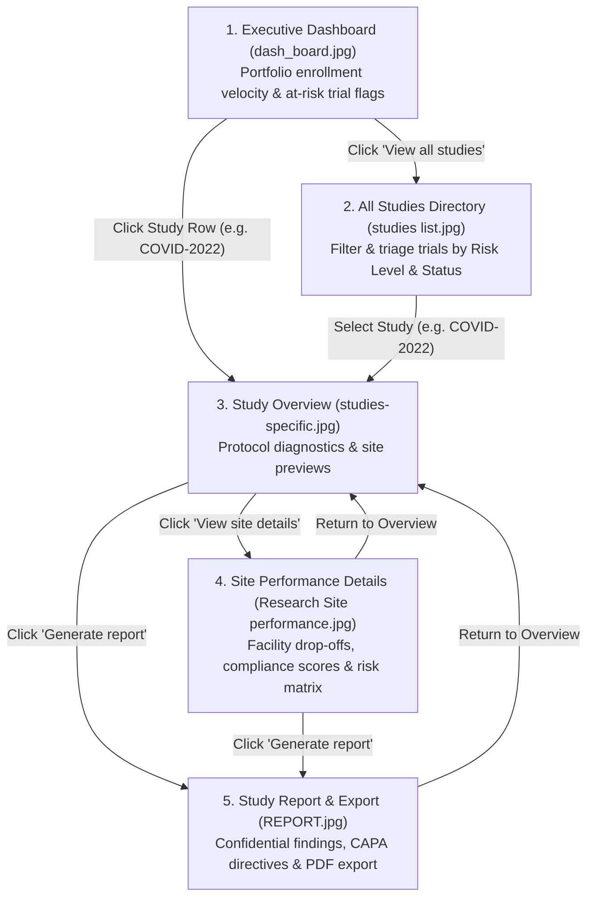

# PaperTrail — Clinical Research & Trial Operations Dashboard

[](https://vitejs.dev/)
[](https://react.dev/)
[](https://www.typescriptlang.org/)
[](https://tailwindcss.com/)
[](LICENSE)

**PaperTrail** is a modern, high-performance Clinical Trial Management & Portfolio Monitoring application built for Clinical Operations Directors, Clinical Research Associates (CRAs), and Trial Monitors. It unifies high-level portfolio oversight, operational site diagnostics, and inspection-ready compliance reporting into a fast, responsive Single Page Application (SPA).

---

## Key Highlights

- **Native SVG Data Visualizations:** Zero external chart libraries. Smooth, responsive monthly enrollment trend curves and progress gauges rendered directly via lightweight native SVG and Tailwind CSS.
- **Client-Side URL State Engine:** Deep-linking and full browser Back/Forward navigation powered by native URL search parameters (`?view=...&id=...`) without external routing dependencies.
- **Strictly Typed Clinical Schema:** End-to-end TypeScript models for multi-site trials, protocol timelines, risk matrices, and regulatory compliance.
- **Mobile-First Responsiveness:** Seamless transition from desktop data grids (`hidden md:table`) to mobile inspection card stacks (`block md:hidden`), maintaining 44px+ touch targets and zero horizontal overflow.
- **Deterministic State Architecture:** Pure, immutable derived state (`useMemo`) calculated synchronously against bundled clinical registries.

---

## 5-Screen Investigative Workflow

PaperTrail is structured around an executive-to-operational drill-down workflow designed around real-world clinical monitoring workflows:



### 1. Research Overview (Executive Dashboard)
- Macro-level KPIs: Active Studies, Patients Enrolled, Overall Enrolment Rate, and Sites at Risk.
- **Monthly Enrollment Trend:** Interactive SVG line chart plotting actual enrollment against target curves across all 12 calendar months with hover tooltips.
- **Enrollment by Study:** High-level progress tracker highlighting enrollment deficits for flagship trials.
- **Priority Studies Summary:** Quick-triage table highlighting protocol phase, status, risk tier, and counts of at-risk trial sites.

### 2. All Studies Directory
- Comprehensive study registry with instant search (debounced 150ms) across titles, protocol numbers, PIs, and research managers.
- Compound filtering by Status (`Active`, `Recruiting`, `Completed`, `Suspended`, `On Hold`, `Inactive`) and Therapeutic Area.
- Metric summary ribbon tracking delayed trials, critical risks, and average portfolio enrollment velocity.

### 3. Study Command Center
- Protocol diagnostic hub with visual milestone timeline bar (`% elapsed`, `months/days remaining`, start & completion dates).
- Diagnostic metrics: Current Enrollment vs. Target, Patients Behind Target, and Sites Needing Attention.
- Protocol-specific enrollment curve and site-by-site performance ranking list.

### 4. Site Performance Details
- Facility-level drill-down for trial operations teams.
- Tracks patient drop-off / subject withdrawal rates (`%`), protocol adherence scores, and facility risk tiers.
- Granular operational matrix across trial centers (e.g. Ongoing, Planned, Completed, and Pending trial sites).

### 5. Study Report & Export
- Confidential, audit-ready clinical research monitoring report.
- Regulatory profile: FDA IND number, IRB approval status, protocol version, and reporting period.
- **Key Findings & CAPA Directives:** Actionable audit cards tagged by severity (`Critical`, `High`, `Medium`) with explicit **RECOMMENDATIONS** (e.g., immediate CRA on-site visits, staff re-training, patient recruitment optimization).
- One-click native print and PDF export triggers.

---

## Technology Stack

| Layer | Technology | Purpose |
|---|---|---|
| **Framework** | [React 18](https://react.dev/) | Component architecture & state management |
| **Build Tool** | [Vite 6](https://vitejs.dev/) | Lightning-fast development & production bundling |
| **Language** | [TypeScript 5](https://www.typescriptlang.org/) | Strict end-to-end typing & compile-time validation |
| **Styling** | [Tailwind CSS 3](https://tailwindcss.com/) | Semantic token-based utility styling |
| **Icons** | [Lucide React](https://lucide.dev/) | Clean, accessible iconography |
| **Charts** | Native SVG + CSS | 100% dependency-free responsive data visualization |

---

## Project Structure

```text
PaperTrailV2.0/
├── README.md                          # Repository documentation
├── AGENTS.md                          # AI coding agent operating guidelines
├── Clinical Research PRD.md           # Product requirements & screen specifications
├── UI templates/                      # High-fidelity reference mockups
│   ├── dash_board.jpg                 # Screen 1 template
│   ├── studies list.jpg               # Screen 2 template
│   ├── studies-specific.jpg           # Screen 3 template
│   ├── Research Site performance.jpg  # Screen 4 template
│   └── REPORT.jpg                     # Screen 5 template
└── clinical-research-dashboard/       # Source application
    ├── index.html
    ├── package.json
    ├── vite.config.ts
    ├── tailwind.config.js
    ├── tsconfig.json
    └── src/
        ├── main.tsx                   # React root entry point
        ├── App.tsx                    # Shell layout & URL state engine
        ├── index.css                  # Tailwind directives & design tokens
        ├── types/
        │   └── project.ts             # Domain models (ClinicalProject, TrialSite, etc.)
        ├── data/
        │   └── projects.json          # Bundled clinical trial dataset
        └── components/
            ├── layout/
            │   ├── Header.tsx         # Top bar (Search, Notifications, Profile)
            │   ├── Sidebar.tsx        # Persistent navigation sidebar
            │   └── Container.tsx      # Standardized responsive wrapper
            ├── dashboard/
            │   ├── ExecutiveDashboard.tsx     # Screen 1 overview
            │   ├── EnrollmentTrendChart.tsx   # Native SVG multi-line trend chart
            │   ├── EnrollmentByStudy.tsx      # Progress widget for flagship trials
            │   ├── RecentStudiesTable.tsx     # Summary priority table
            │   ├── MetricRibbon.tsx           # 4-card metric summary ribbon
            │   └── MetricCard.tsx             # Reusable KPI card
            ├── details/
            │   └── ProjectDetailView.tsx      # Study detail view
            └── common/
                ├── StatusBadge.tsx            # Semantic status pills
                ├── RiskBadge.tsx              # Semantic risk level indicators
                ├── ProgressBar.tsx            # Accessible enrollment progress bar
                └── EmptyState.tsx             # Zero-data and no-results fallbacks
```

---

## Getting Started

### Prerequisites

- [Node.js](https://nodejs.org/) (version `18.x` or higher recommended)
- `npm` or `yarn`

### Installation

1. Clone the repository:
   ```bash
   git clone https://github.com/mr-wizzy/PaperTrailV2.0.git
   cd PaperTrailV2.0
   ```

2. Navigate into the application directory and install dependencies:
   ```bash
   cd clinical-research-dashboard
   npm install
   ```

### Running Locally

Start the local Vite development server:
```bash
npm run dev
```

Open your browser and navigate to:
```text
http://localhost:5173/
```

### Building for Production

Compile and bundle the application with strict TypeScript checking:
```bash
npm run build
```

Preview the production build locally:
```bash
npm run preview
```

---

## URL Navigation Contract

The application uses URL search parameters to switch views and synchronize history:

| View | Route / Query String | Description |
|---|---|---|
| **Executive Dashboard** | `/?view=dashboard` | Macro-level overview with enrollment trend chart |
| **All Studies** | `/?view=studies` | Searchable and filterable clinical trial directory |
| **Study Command Center** | `/?view=study&id=COVID-2022` | Protocol diagnostics and timeline monitoring |
| **Site Performance** | `/?view=sites&id=COVID-2022` | Facility-level compliance and drop-off matrix |
| **Study Report & Export** | `/?view=report&id=COVID-2022` | Formal findings, CAPA directives, and print view |

---

## Design System & Semantic Color Tokens

Status and risk tags adhere to strict semantic color tokens:

| Status / Risk Level | Visual Styling |
|---|---|
| **Active** | `bg-emerald-50 text-emerald-700 border-emerald-200` |
| **Recruiting** | `bg-blue-50 text-blue-700 border-blue-200` |
| **Completed** | `bg-slate-50 text-slate-700 border-slate-200` |
| **Suspended / On Hold** | `bg-amber-50 text-amber-700 border-amber-200` |
| **Inactive** | `bg-rose-50 text-rose-700 border-rose-200` |
| **Critical Risk** | `bg-rose-50 text-rose-700 border-rose-200 font-semibold` |
| **High Risk** | `bg-amber-50 text-amber-700 border-amber-200` |
| **Medium Risk** | `bg-yellow-50 text-yellow-700 border-yellow-200` |
| **Low Risk** | `bg-emerald-50 text-emerald-700 border-emerald-200` |

---

## Contributing & Development Guidelines

See [`AGENTS.md`](AGENTS.md) and [`Clinical Research PRD.md`](Clinical%20Research%20PRD.md) for architectural constraints, coding standards, and execution workflows.

---

## License

This project is licensed under the MIT License — see the [LICENSE](LICENSE) file for details.
